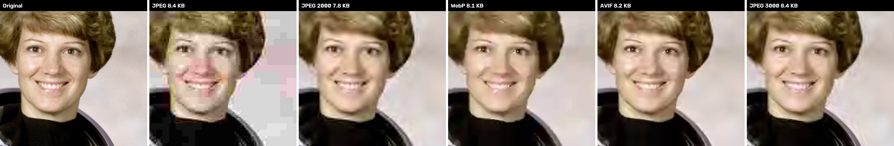

# JPEG 3000 (prototype)

An experimental image format (`.j3k`) that makes files much smaller than JPEG at the same
image quality, without JPEG's blocky artifacts at high compression. Version 5 starts the
entropy coder from probabilities learned on other photos and adds trellis ("dependent")
quantization: on photos it was never tuned on, it now matches AVIF at equal PSNR. Version 4
added a directional wavelet transform; version 3 an in-browser decoder, transparency and
support for images of any size.



**Browser viewer:** [`web/index.html`](web/index.html) opens `.j3k` files in any browser
(decoding runs on your device, nothing is uploaded). Serve the `web` folder, for example with
`python -m http.server --directory web`.

## Results

Average file size relative to JPEG, at equal image quality
(4 photos x 5 compression levels, details in [results.md](results.md)):

| Format | At equal PSNR | At equal SSIM |
|---|---:|---:|
| JPEG (1992) | reference | reference |
| JPEG 2000 (2000) | −43 % | −22 % |
| WebP (2010) | −35 % | −26 % |
| AVIF (2019) | −55 % | −46 % |
| JPEG 3000 v3 | −49 % | −34 % |
| JPEG 3000 v4.1 | −52 % | −38 % |
| **JPEG 3000 v5** | **−53 %** | **−40 %** |

- **PSNR**: pixel-by-pixel fidelity. **SSIM**: perceived similarity, closer to what the eye sees.
- Against its predecessor JPEG 2000 (OpenJPEG, 9/7 wavelet): files **18 % smaller** at equal PSNR
  and **23 % smaller** at equal SSIM, smaller on all 20 measurements.
- Against WebP: smaller on all 20 measurements, in PSNR and in SSIM.
- **AVIF is still better on these 4 photos**, but the gap keeps shrinking: its files are about
  3 % smaller than JPEG 3000's at equal PSNR (6 % for version 4.1, 11 % for version 3) and 9 %
  smaller at equal SSIM (12 % for version 4.1, 18 % for version 3). JPEG 3000 v5 produces
  smaller files than AVIF in 7 measurements out of 20 in PSNR (the cat photo at every level, the
  astronaut and the coffee cup at the highest quality; plus 1 tie), and in 5 out of 20 in SSIM
  (the cat photo at every level).

How JPEG 3000 compares with AVIF, in more detail (Bjøntegaard delta rate, AVIF as the
reference, + means JPEG 3000 needs more bytes):

| Photo set | Version | At equal PSNR | At equal SSIM |
|---|---|---:|---:|
| 5 tuning photos (the 4 test photos + scikit-image's motorcycle) | v3 | +8.9 % | +21.6 % |
| | v4 | +3.2 % | +14.7 % |
| | v4.1 | +2.9 % | +13.5 % |
| | **v5** | **+0.5 %** | **+9.5 %** |
| 9 photos never used for tuning | v3 | +6.4 % | +19.1 % |
| | v4 | +1.8 % | +12.7 % |
| | v4.1 | +1.7 % | +11.5 % |
| | **v5** | **−0.6 %** | **+7.8 %** |

Version 5's starting probabilities were learned on a third set of 39 small pictures that
contains none of the photos above.

Correction: the version 4 README gave +4.0 % / +15.7 % for the photos never used for tuning.
One of them, scikit-image's `coins`, turned out to hide an old JPEG 8x8 grid: AVIF gains 1.5 dB
on it when the grid is aligned and loses that gain once the picture is shifted by 1 to 4 pixels.
It is now measured shifted by 3 pixels, which gives the numbers above.

- On the 9 photos never used for tuning, version 5 needs on average slightly **fewer** bytes
  than AVIF at equal PSNR (−0.6 %): the first version to get there. It is still behind at
  equal SSIM.
- The gap depends on the bitrate. JPEG 3000 is at its best at high quality and at its worst at
  low bitrates: below about 0.4 bit/pixel AVIF stays clearly ahead on the astronaut and
  grayscale photos (it needed 20 to 26 % fewer bytes than version 4.1 there). That's where
  AV1's block prediction and deringing filters shine.
- It beats AVIF in PSNR on 7 of the 14 photos (a cat −8 %, a landscape −26 %, a rocket −10 %,
  gravel, a microscope slide, coffee...) and loses clearly on pictures with large flat or black
  areas or fine noise (Hubble deep field +23 %, retina +18 %, coins +6 %).
- The SSIM gap is larger for two measured reasons. AVIF stores colours at half resolution
  (4:2:0) and spends the saved bytes on brightness, which is all this SSIM looks at: on the
  astronaut and motorcycle photos, at equal file size, version 4.1's brightness error was 20 to
  35 % higher than AVIF's while its colour error was equal or lower. And at low bitrates AV1's
  block prediction simply codes brightness better (it keeps about half a dB on the grayscale
  photo). Shifting bits from colours to brightness, or quantizing flat areas more finely like
  AVIF's perceptual tuning does, was measured: both only trade PSNR for SSIM.

To read these numbers honestly:

- Only 4 test photos in the public benchmark (3 colour, 1 grayscale), all small (0.14 to 0.26 megapixels).
- JPEG XL, the other modern format, could not be tested here.
- These numbers can't be compared with version 2's: version 2 was measured on Windows
  wallpapers, against a weaker JPEG 2000 encoder (Jasper, 5/3 wavelet) and without AVIF.

## What's new in version 5

Format `J3K5`: files are **2.5 % smaller at equal PSNR and 3.5 % smaller at equal SSIM** than
version 4.1 (Bjøntegaard delta rate over the 5 tuning photos; every photo improves, and small
files gain the most). Version 4 and version 3 files (`J3K4`, `J3K3`) can still be read, in
Python and in the browser.

| Change | Gain |
|---|---:|
| **Learned starting probabilities.** Earlier versions started every file with all probabilities at 50 % and paid to learn them again each time. Version 5 starts its 35 000 contexts, the mixer weights and the wavelet-direction coder from values learned on other photos, stored as a 17 KB table that is part of the format (the same idea as AV1's default probability tables). Rebuild it with `tools/train_priors.py` | −1.4 % PSNR, −1.3 % SSIM (−3 to −7 % on files under 5 KB) |
| **Trellis ("dependent") quantization**, the technique VVC uses. Each value is rebuilt from one of two interleaved grids, picked by a 4-state machine that follows the parity of the previous values; the two grids together are twice as fine as either. The encoder searches each row of a block with a Viterbi trellis that weighs the error against the exact cost in bits. It replaces version 4's dead-zone quantizer | −1 % PSNR, −2.7 % SSIM, mostly above 0.7 bit/pixel (+0.1 to +0.2 dB) |
| Reconstruction point of each value moved slightly outward | small gain on both metrics |

Measured and rejected:

- Quantization adapted to each 32×32 zone (finer in flat areas, like AVIF's perceptual tuning):
  it only trades PSNR for SSIM (strength 0.5: +2.7 points of PSNR gap for −1.8 points of SSIM
  gap on the photos never used for tuning).
- Coarser quantization of the finest colour details (a soft 4:2:0), or a higher colour factor:
  the same kind of trade.
- A fifth mixed model fed with a wider neighbourhood (neighbours of the parent coefficient,
  right and bottom neighbours in already decoded bands): −0.2 %, not worth the extra decoder
  code. Gradient-boosted trees trained on every neighbour available show that at most about 2 %
  is left to gain in context modelling.
- Keeping a single path in the trellis for quiet rows to speed the encoder up: little speed
  gained, quality lost.

## What's new in version 4.1

Only the encoder changes: files are still `J3K4` and every decoder (Python, browser) reads
them unchanged. About −0.3 % in PSNR and −1.2 % in SSIM against version 4, on photos never used
for tuning.

| Change | Effect |
|---|---|
| Directions chosen on the energy actually left after the full lifting step, instead of a simpler prediction error | small gain on both metrics |
| Colour quantization factor 1.7, slightly lower at strong compression and higher at high quality (the factor is stored in each file) | better in PSNR **and** SSIM |
| Nearly empty 32×32 blocks (at most four ±1 values) emptied when the added error is worth less than the bits saved | mostly SSIM |

Measured and rejected: perceptual quantization (errors weighted by local texture; it only trades
PSNR for SSIM), rate-dependent direction thresholds, a 4-tap half-pixel interpolation (+0.1 %,
not worth a file format change), richer contexts for signs (already 0.90 to 0.96 bit per sign)
and for "is this coefficient zero?".

## What's new in version 4

Format `J3K4`, about **4 % smaller files than version 3** at equal quality (−4.3 % in PSNR,
−4.9 % in SSIM over the 5 tuning photos, up to −13.7 % on the coffee photo). Version 3 files
(`J3K3`) can still be read, in Python and in the browser.

| Change | Gain |
|---|---:|
| Directional wavelet (adaptive directional lifting): in each 16×16 block, the encoder picks one of 7 directions and the wavelet filters along it, so slanted edges stay cheap instead of spreading over many coefficients. Directions are chosen on brightness, reused for colours, and coded in about 3 adaptive bits per block | about −5 % |
| Rate-distortion optimized quantization (encoder only): each value is chosen among "keep", "one less" and "zero" by weighing the error against its exact cost in bits under the current arithmetic coder state | −0.6 % (−2 % in SSIM) |
| "Is the amplitude above 1?" also decided by mixing 4 models | −0.3 % |
| Finest details quantized 10 % more coarsely | −0.2 % |

Measured and rejected: a Wiener restoration filter after decoding (+0.01 to +0.08 dB), predicting
colours from brightness like AV1's CfL (colours are only 10 to 22 % of the bytes; −0.5 %), a
secondary probability estimation stage (SSE, −0.14 %), a bit-cost criterion for directions, a
quantization strength that depends on the step, other per-level step adjustments.

## What's new in version 3

Format `J3K3`, about **6 % smaller files than version 2** at equal quality (Bjøntegaard delta
rate over the 4 test photos plus scikit-image's motorcycle photo, PSNR and SSIM alike;
up to −9.5 % on some photos):

| Change | Gain |
|---|---:|
| Wavelet transform of any image size, even odd: version 2 padded images to a multiple of 32 or 64 pixels and spent bits on pixels that don't exist | −2.1 % (up to −4.5 %) |
| Signs predicted from neighbouring coefficients (and from brightness, for colours) instead of stored raw | −1.5 % |
| 32×32 "all zero" blocks instead of 4×4 | −1.3 % |
| "Is this coefficient zero?" decided by mixing 4 models with a small online-learning network (logistic mixing, as in PAQ compressors), in integer arithmetic so every decoder gets the exact same result | −1.3 % |
| Logarithmic context classes for coefficient amplitudes | −0.1 % |

Measured and rejected because they gained nothing or made files bigger: quadtree zero blocks
(16 → 8 → 4), per-band reconstruction offsets (at most +0.02 dB even with perfect knowledge),
sibling subbands or farther neighbours added to the main context (too many states to learn;
they only pay off inside the mixer), parent sign as a sign context.

Compatibility:

- **Any browser** can open `.j3k` files with [`web/j3k.js`](web/j3k.js), a dependency-free
  decoder (about 0.4 s for a 1-megapixel photo). It gives exactly the same pixels as the
  Python decoder, which the tests check. On a web page:
  ```html
  <script src="j3k.js"></script>
  
  <script>J3K.polyfill();</script>
  ```
- **Transparency**: RGBA and grayscale+alpha images; the alpha channel is stored losslessly.
- **Any size**, from 1×1 pixel up to 268 million pixels, odd sizes included.
- **More input files**: PNG, JPEG, WebP, AVIF, TIFF, BMP, GIF, 16-bit images, palette images,
  and HEIC/HEIF (iPhone) if `pillow-heif` is installed. Phone photos are turned upright
  using their EXIF orientation.
- **Pillow plugin**: after `import jpeg3000`, `PIL.Image.open("photo.j3k")` works, so any
  Python program built on Pillow can read `.j3k`.
- Clear errors for damaged files or files from another version (`J3K2` files need version 2:
  `git checkout v2`; version 5 still reads `J3K4` and `J3K3` files).

## Usage

Python 3 with `numpy` and `pillow` (`pip install -r requirements.txt`).

```
python jpeg3000.py encode photo.png photo.j3k --quality 50
python jpeg3000.py encode photo.png photo.j3k --size 50000
python jpeg3000.py decode photo.j3k photo.png
python jpeg3000.py info photo.j3k
python test_jpeg3000.py
python compare.py
python tools/train_priors.py my_photos/
```

- `--quality`: from 1 (tiny file) to 100 (almost lossless), 50 by default.
- `--size`: maximum file size in bytes; the best quality that fits is chosen.
- `decode` writes PNG, JPEG, WebP, TIFF or BMP depending on the extension (transparent
  images are placed on white for formats without transparency).
- `compare.py` needs `opencv-python` and `scipy`; a format missing from your OpenCV build is skipped.
- The test suite also checks the JavaScript decoder against the Python one when Node.js is installed,
  and that sample files from versions 3 and 4 still decode to the exact same pixels.
- `tools/train_priors.py` relearns the starting probabilities from a folder of photos (add
  `--write` to update both decoders). The table is part of the format: changing it makes
  existing `J3K5` files unreadable, so it goes with a new format version.

The command line messages are in French.

## How it works

| | JPEG (1992) | JPEG 3000 |
|---|---|---|
| Transform | 8x8 pixel blocks | directional CDF 9/7 wavelets over the whole image: no blocky artifacts, edges followed in 7 directions |
| Quantization | fixed tables | step tuned to each subband, two interleaved grids picked by a 4-state machine (dependent quantization), values chosen by a rate-distortion trellis |
| Entropy coding | Huffman | adaptive binary arithmetic coding with contexts (neighbours, parent scale, sibling subbands, brightness for colours), logistic mixing of 4 models, starting probabilities learned on other photos |

## Limitations

- It's a Python prototype: on an Apple M3, about 9 s to encode and 3 s to decode a
  1-megapixel photo at quality 50 (version 5's trellis search makes encoding three times
  slower than version 4.1). The JavaScript decoder takes about 0.4 s.
- The starting probabilities were learned on only 39 small pictures; a larger and more varied
  set would probably do a little better.
- Only the decoder exists in JavaScript; encoding needs Python.
- Browsers, phones and image editors don't open `.j3k` natively: you need `j3k.js`, the
  Python tool or the Pillow plugin.
- "JPEG" is a trademark of the JPEG committee: the format would need another name to be distributed.
